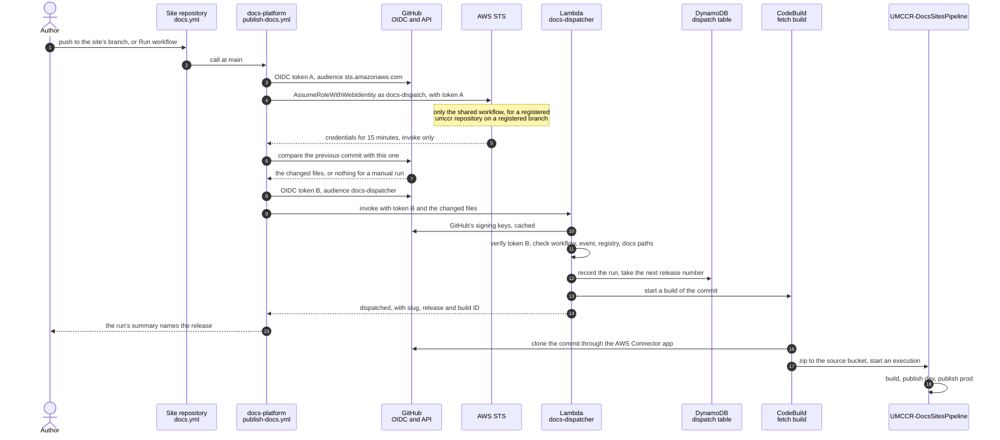
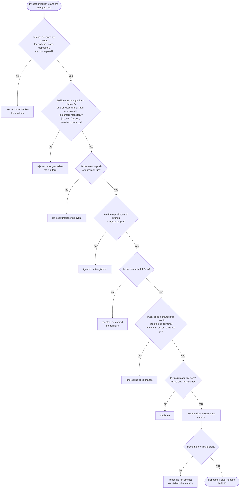

# Plan: publishing from GitHub

> **Status: plan, not in effect; revised 2026-11-19.** Publishing still runs as
> [ADR-0006](../design/adr/0006-dispatched-publishing.md) and [deploy.md](../site/deploy.md) describe: the
> organisation webhook calls the dispatcher's function URL, which checks the webhook's signature. This page is the
> plan for replacing that, proposed in [ADR-0009](../design/adr/0009-dispatch-from-github-actions.md), deferred on
> 2026-10-15 ([issue](../issues/2026-10-14-dispatcher-function-url.md)) and revised on 2026-11-19: the role trusts
> GitHub's claims instead of token subjects, umccr/infrastructure owns the GitHub OIDC provider, the shared workflow
> holds the role's ARN, and the site template lives in umccr/docs-toolkit
> ([what changed](../design/adr/0009-dispatch-from-github-actions.md#revised-2026-11-19)). The first version was
> implemented with tests on 2026-10-14 and reverted before merge;
> [what implementing it changes](#what-implementing-it-changes) is written for this version.

How a push to a site's repository would become a release under the plan, and how to deploy it. For the platform
team.

## In short

A site's repository runs a short workflow on each push to its branch. The workflow calls the shared workflow in this
repository, which signs in to the toolchain account through GitHub OIDC as `docs-dispatch`, a role that can do one
thing: invoke the dispatcher. IAM lets only the shared workflow take the role, and only when it runs for a
registered umccr repository on a registered branch. The shared workflow hands the dispatcher a second GitHub OIDC
token, in which GitHub vouches for the repository, branch and commit. The dispatcher checks that token against the
site registry and starts the fetch build, which starts `UMCCR-DocsSitesPipeline`.

Nothing on this path can be invoked from the internet, and no site repository holds a credential or a setting.

## The pieces

| Piece | Where | What it does |
| --- | --- | --- |
| The site's workflow | `.github/workflows/docs.yml` in each site's repository, copied from `templates/docs-workflow.yml` in umccr/docs-toolkit (new) | runs on a push to the site's branch, or on **Run workflow**, and calls the shared workflow |
| The platform site's workflow | `.github/workflows/platform-site.yml` (new) | the same, for `/platform/` |
| The shared workflow | `.github/workflows/publish-docs.yml` (new) | holds the role's ARN; signs in as `docs-dispatch`, finds the changed files, invokes the dispatcher and reports its answer |
| GitHub OIDC provider | toolchain account, from `terraform/stacks/bastion_oidc/` in umccr/infrastructure (new), the stack for the account's OIDC providers | lets GitHub Actions sign in to the account, for the dispatcher and any later service. IAM allows one provider per URL in an account; Terraform writes its ARN to the SSM parameter `/iam/github_actions_oidc_provider_arn` |
| Role `docs-dispatch` | toolchain account, `infrastructure/toolchain/dispatcher.ts` (changed) | trusts only the shared workflow, for the umccr organisation's registered repositories and branches; may only invoke the dispatcher |
| Lambda `docs-dispatcher` | `app/dispatcher/` (changed) | verifies the token, decides, numbers the release and starts the fetch build. No URL, no resource policy |
| Dispatch table | DynamoDB, in the same stack | the workflow run attempts already handled, and each site's release counter |
| Fetch build and `UMCCR-DocsSitesPipeline` | [`fetch-build.ts`](../../infrastructure/toolchain/fetch-build.ts), [`sites-pipeline.ts`](../../infrastructure/toolchain/sites-pipeline.ts) (unchanged) | clone the commit, zip it, then build and publish to dev, then prod |

## The whole path



The workflow run takes seconds, the fetch build a minute or two, and the release is usually live a few minutes after
the push.

## Step by step

### 1. The site's workflow starts it

The site's `.github/workflows/docs.yml` runs on a push to the site's branch (`main` in the template) and on **Run
workflow**. Its calling job grants two permissions: `id-token: write`, so that the job can ask GitHub for OIDC
tokens, and `contents: read`, for the compare API. It calls the shared workflow at `main` and passes nothing else: no
secret, variable or input. A called workflow can never have more permissions than its caller grants.

```yaml
name: Publish docs
on:
  push:
    branches: [main] # the site's registered branch
  workflow_dispatch:
permissions: {}
jobs:
  publish:
    permissions:
      id-token: write
      contents: read
    uses: umccr/docs-platform/.github/workflows/publish-docs.yml@main
```

### 2. The shared workflow signs in to AWS

**Sign in to AWS as docs-dispatch**: `aws-actions/configure-aws-credentials`, pinned to a commit, with the role's
ARN written in the shared workflow, asks GitHub for token A, with audience `sts.amazonaws.com`, and calls
`AssumeRoleWithWebIdentity`. IAM accepts the token only when each of these claims has a value the role's trust
policy lists. The lists come from [`infrastructure/sites.ts`](../../infrastructure/sites.ts):

| Claim | Must be | For today's registry |
| --- | --- | --- |
| `aud` | the AWS audience | `sts.amazonaws.com` |
| `repository_owner_id` | the umccr organisation's ID | `gh api orgs/umccr --jq .id` prints it |
| `repository` | a registered repository | `umccr/docs-platform`, `umccr/management-knowledgebase`, `umccr/orcasonar` |
| `ref` | a registered branch | `refs/heads/main` |
| `job_workflow_ref` | the shared workflow, at `main` or at a commit | `umccr/docs-platform/.github/workflows/publish-docs.yml@refs/heads/main`, or `@` and a 40-character commit |

The statement the CDK app would generate for today's registry:

```json
{
  "Effect": "Allow",
  "Principal": {
    "Federated": "arn:aws:iam::<toolchain account>:oidc-provider/token.actions.githubusercontent.com"
  },
  "Action": "sts:AssumeRoleWithWebIdentity",
  "Condition": {
    "StringEquals": {
      "token.actions.githubusercontent.com:aud": "sts.amazonaws.com",
      "token.actions.githubusercontent.com:repository_owner_id": "<umccr organisation ID>",
      "token.actions.githubusercontent.com:repository": [
        "umccr/docs-platform",
        "umccr/management-knowledgebase",
        "umccr/orcasonar"
      ],
      "token.actions.githubusercontent.com:ref": ["refs/heads/main"]
    },
    "StringLike": {
      "token.actions.githubusercontent.com:job_workflow_ref": [
        "umccr/docs-platform/.github/workflows/publish-docs.yml@refs/heads/main",
        "umccr/docs-platform/.github/workflows/publish-docs.yml@????????????????????????????????????????"
      ]
    }
  }
}
```

- In `StringLike`, `?` matches one character, so the second pattern admits the shared workflow pinned to a commit,
  and no other ref.
- The policy never matches the token's subject. GitHub builds `sub` in two formats: repositories created since 15
  July 2026, renamed or transferred since, or opted in, carry IDs
  (`repo:umccr@<owner ID>/<name>@<repository ID>:ref:refs/heads/main`), and other repositories do not. Every
  registered repository uses the first format, and a rename or a transfer moves a repository to it. The claims above
  read the same in both, and for GitHub's provider IAM accepts `job_workflow_ref` in place of `sub`.
- `repository_owner_id` matters because this repository is public. Any repository on GitHub can call
  `publish-docs.yml`; the organisation's ID stops one elsewhere from taking the role.
- `repository` and `ref` are separate lists, so a registered repository passes on any registered branch. The
  dispatcher pairs them against the registry.

Any other repository, a fork, a pull request (its ref is `refs/pull/<n>/merge`), a tag, another branch, or a job
that does not run the shared workflow fails here. The credentials last 15 minutes and allow only
`lambda:InvokeFunction` on `docs-dispatcher`.

The role's ARN names the toolchain account. It is public in this repository's workflow file and in each run's log,
which is fine: neither is a credential ([SECURITY.md](../../SECURITY.md)). A test checks the ARN against the CDK
app's account and the role's name.

### 3. The shared workflow asks the dispatcher

1. **The changed files.** Actions' copy of the push event does not list them, so the step asks GitHub's compare API
   for `<previous commit>...<this commit>`, renamed files included. It sends `null` instead for a manual run, a new
   branch, a failed comparison or 300 files or more (the API's limit), and the dispatcher then assumes the docs
   changed.
2. **Token B**: a second OIDC token, with audience `docs-dispatcher`. It is masked in the log, passed to `jq`
   through the environment rather than the command line, and deleted from the runner's disk when the step ends.
3. **The request**: `aws lambda invoke --function-name docs-dispatcher` with `{"token": "<token B>", "files": [...]}`,
   using the role's credentials: a direct, synchronous call, with no URL involved.
4. **The answer**: the step writes it to the run's summary, and fails the run on `rejected`, `start-failed` or an
   error in the function. An error's message can name AWS resources, so only its type is printed.

Two tokens, because the role only proves that the shared workflow runs for *some* registered repository on *some*
registered branch. Token B proves which repository, branch and commit, signed by GitHub, so a site cannot ask for
another site's release, or for a commit it did not push. The two audiences differ, so neither token is accepted in
the other's place.

### 4. The dispatcher decides

The changed `app/dispatcher/dispatch.ts` checks, in this order, and answers at the first check that fails:



- The repository, branch and commit come from token B's signed claims, never from the request body; the slug,
  configuration path, toolkit version and stages come from the registry. The changed files are the only thing the
  request decides, and they only decide whether to build.
- The token is verified with `aws-jwt-verify`, already a dependency for the session Lambda, against the keys GitHub
  publishes at `https://token.actions.githubusercontent.com/.well-known/jwks`. The dispatcher fetches them once per
  execution environment, and again when a token names a key it does not hold.
- Recording the run attempt before taking a release number means an invocation the AWS CLI retries starts nothing
  twice. **Re-run** in GitHub is a new attempt, so it publishes again. A failed start forgets the attempt, so a retry
  can start the build.
- The dispatcher logs one line per request, with the repository, branch, commit, event and run. It never logs the
  token.

### 5. From the dispatcher to the site

1. The dispatcher starts the fetch build with the site, commit, release, configuration path, toolkit ref and stages
   as variables, and the GitHub connection as the source's credentials.
2. The fetch build clones that commit through the organisation's AWS Connector for GitHub app, resolves a toolkit
   ref of `latest` to its release tag, zips the checkout without `.git` to `sources/<slug>/<commit>.zip`, and starts
   `UMCCR-DocsSitesPipeline` on that object.
3. `UMCCR-DocsSitesPipeline` builds the site with no write access, then publishes it to dev and then prod as
   `docs-publisher`, narrowed to the site's own prefixes. A publish skips when a newer release is already live.

## The dispatcher's answers

| Answer | When | The run | What to do |
| --- | --- | --- | --- |
| `dispatched` | a release started | succeeds; the summary names the release and build | watch `UMCCR-DocsSitesPipeline` |
| `ignored`, `no-docs-change` | the push changed nothing under the site's `docsPaths` | succeeds | nothing; **Run workflow** publishes anyway |
| `ignored`, `not-registered` | the repository and branch are not a registered pair, though each is registered. Rare: the role refuses most of these first | succeeds | run on the site's registered branch, or register the site ([onboarding](../site/runbook.md#register-a-site)) |
| `ignored`, `unsupported-event` | an event other than a push or a manual run | succeeds | nothing |
| `duplicate` | the same run attempt asked twice, for example an invocation the AWS CLI retried | succeeds | nothing |
| `rejected`, `invalid-token` | token B failed its signature, issuer, audience or expiry check | fails | use the shared workflow unchanged; the dispatcher's log names the check |
| `rejected`, `wrong-workflow` | the request did not come through `publish-docs.yml` at `main` or a commit, for a umccr repository. Rare: the role refuses these first | fails | call the shared workflow, as the template does |
| `start-failed` | the fetch build could not start | fails | the dispatcher's log has the AWS error; fix it, then **Re-run** |
| none: the run fails at **Sign in to AWS** | the role refused the token: the repository or branch is not in the deployed registry, the run is on another branch, the job does not run the shared workflow at `main` or a commit, or `docs-dispatch` is not deployed yet | fails | register the site and let pipeline 1 deploy it; run on the registered branch; call the shared workflow as the template does |
| none: the run fails before it starts, the nested job requesting `id-token: write` | the calling job does not grant `id-token: write` and `contents: read` | fails | use the template unchanged |

## What each control stops

| Threat | Stopped by |
| --- | --- |
| Anyone on the internet invoking the dispatcher | no function URL and no resource policy; only `docs-dispatch` may invoke it |
| A repository outside the umccr organisation calling the shared workflow, which is public | the role trusts only the organisation's ID (`repository_owner_id`) |
| An unregistered repository, a fork, a pull request, a tag or another branch publishing | the role trusts only registered repositories (`repository`) and branches (`ref`) |
| A workflow other than the shared one taking the role, or sending a crafted request | `job_workflow_ref` in the role's trust, and the dispatcher's own check of it |
| A site asking for another site's release, or for a commit it did not push | the repository, branch and commit come from GitHub's signature on token B, and the dispatcher pairs them against the registry; the slug comes from the registry |
| The AWS sign-in token used as a dispatcher request, or the other way round | the two tokens have different audiences |
| One request starting two builds | the run attempt is recorded before the release number is taken |
| A leaked token | both expire within minutes; token B is masked in logs and deleted from the runner |
| A repository's subject format changing, after a rename, a transfer or an opt-in | the role matches claims, not subjects |

## What implementing it changes

The first version's implementation, written on 2026-10-14, passed every check CI ran then (328 tests, lint, format,
actionlint, zizmor, detect-secrets, the information boundary) and a template diff against the deployed toolchain
stack, before it was reverted. Re-creating it for this version means the changes below.

### umccr/infrastructure

A new stack, `bastion_oidc`, holds the bastion account's OIDC identity providers. GitHub Actions' provider is its
first; the dispatcher is the first service to trust it, and other services that let GitHub Actions call a Lambda
function or anything else in the account trust the same provider. Each service keeps its own roles in its own
stack, as `docs-dispatch` stays in this one, so this stack holds the providers and their SSM parameters only.

It is a stack of its own rather than a change to `terraform/stacks/bastion`, which is pinned to Terraform 0.11 and
AWS provider 2.4 and manages the account's service users: a plan there would cover all of it. `bastion_ecr` is the
pattern to follow.

| File | Change |
| --- | --- |
| `terraform/stacks/bastion_oidc/main.tf` | new: Terraform 1.5.7 or later; state at `bastion_oidc/terraform.tfstate` in `umccr-terraform-states`, locked with `terraform-state-lock`; an AWS provider from 6.x, where `thumbprint_list` is optional (5.21.0, which other stacks pin, requires one, though IAM no longer uses it for GitHub); `aws_iam_openid_connect_provider` for `https://token.actions.githubusercontent.com` with the client ID `sts.amazonaws.com`; `aws_ssm_parameter` `/iam/github_actions_oidc_provider_arn` holding its ARN |
| `terraform/stacks/bastion_oidc/outputs.tf` | new: the provider's ARN |
| `terraform/stacks/bastion_oidc/README.md` | new: the stack holds the bastion account's OIDC providers, and services keep the roles that trust them in their own stacks; applied in the bastion account, in the default workspace; IAM allows one provider per URL in an account, so every role there that trusts GitHub Actions uses this one; the services that use it, starting with the docs dispatcher; the order across repositories, as `umccr_docs_domain`'s README gives it |

### umccr/docs-platform

| File | Change |
| --- | --- |
| `app/dispatcher/protocol.ts` | new: the contract shared by the Lambda, the CDK app and the tests: GitHub's issuer, the dispatcher's token audience `docs-dispatcher`, the shared workflow's path, the function name `docs-dispatcher`, the umccr organisation's ID |
| `app/dispatcher/github-token.ts` | new: `JwtRsaVerifier` for GitHub's issuer, audience and keys, with 30 seconds' grace; reads `repository`, `repository_owner_id`, `ref`, `ref_type`, `sha`, `event_name`, `job_workflow_ref`, `run_id`, `run_attempt` |
| `app/dispatcher/dispatch.ts` | the request becomes `{token, files}`, and the checks become the ones in the flowchart above; the answer becomes `{outcome, reason, slug, commit, release, buildId}`, with AWS errors in the log only |
| `app/dispatcher/index.ts` | the token verifier replaces the Secrets Manager client; the table records `run#<run_id>-<run_attempt>` instead of webhook delivery IDs, and the fetch build's idempotency token comes from the run attempt |
| `infrastructure/toolchain/dispatcher.ts` | no function URL and no secret; `functionName: 'docs-dispatcher'`; role `docs-dispatch`, trusting the provider whose ARN it reads from SSM, with the conditions in [step 2](#2-the-shared-workflow-signs-in-to-aws) generated from `dispatchRegistry()`, and `lambda:InvokeFunction` on the function only; a synth-time check of the trust policy's length, counting the provider's ARN at its deployed length; output `DispatchRoleArn` |
| `infrastructure/config.ts` | `DOCS_DISPATCH_ROLE_NAME = 'docs-dispatch'`; `GITHUB_OIDC_PROVIDER_ARN_PARAMETER = '/iam/github_actions_oidc_provider_arn'` |
| `infrastructure/sites.ts`, `infrastructure/toolchain/site-publishing.ts` | doc comments: the workflow instead of the webhook |
| `.github/workflows/publish-docs.yml` | new: the shared workflow, with the role's ARN written in it; `aws-actions/configure-aws-credentials` pinned to a commit, `role-duration-seconds: 900` |
| `.github/workflows/platform-site.yml` | new: calls it with `./`, which needs a `zizmor: ignore[self-repository]` until the pinned actionlint accepts `$/` |
| `scripts/check-dispatcher.sh` | new: the post-deploy check in [step 5](#5-check-the-deploy) below |
| `test/dispatcher.test.ts`, `test/github-token.test.ts`, `test/publish-workflow.test.ts`, `test/pipeline-stack.test.ts` | the dispatcher's checks; the verifier against real RSA signatures; the workflow's own script against stubbed `gh`, `curl` and `aws`, and its role ARN against `TOOLCHAIN_ENVIRONMENT` and `DOCS_DISPATCH_ROLE_NAME`; no function URL, the role's trust conditions and invoke-only policy, the trust policy's length. Drop `AwsSolutions-SMG4` from the pipeline test's accepted rules: the secret goes. The hosting stack's test keeps it, for the session signing key |
| `docs/site/deploy.md`, `runbook.md`, `design.md`, `tech.md`, `publishing.md`, `onboarding.md`, `project.md`, `changelog.md`; `README.md`, `SECURITY.md` | the workflow instead of the webhook |
| `docs/design/adr/`, `docs/issues/2026-10-14-dispatcher-function-url.md`, `docs/plans/implementation-plan.md` | ADR-0009 to accepted, and ADR-0006 to superseded in part; the issue resolved; the production task done |

`@aws-sdk/client-secrets-manager` stays: the session Lambda reads its signing key with it.

### umccr/docs-toolkit and the sites

| Repository | Change |
| --- | --- |
| `umccr/docs-toolkit` | `templates/docs-workflow.yml` (new): the site's caller, as in [step 1](#1-the-sites-workflow-starts-it), at `@main`, saying when to pin a commit instead; linked from the onboarding page |
| each site's repository | `.github/workflows/docs.yml`, the template's copy, with the registered branch under `on.push` |

## Deploying it

The order matters: the role needs the GitHub OIDC provider, and the sites call `publish-docs.yml` at `main`, so
umccr/infrastructure goes first, then this repository, then the sites.

### Before you start

| For | You need |
| --- | --- |
| Steps 1, 2, 4, 5 and 7 | admin on the toolchain (bastion) account through AWS SSO, here the `bastion-admin` profile |
| Step 2 | Terraform 1.5.7 or later, and merge rights on `umccr/infrastructure` |
| Step 7's site check | the `dev` profile, for the dev account |
| Step 6 | an owner of the umccr GitHub organisation |
| Steps 3, 4 and 8 | merge rights on `umccr/docs-toolkit`, `umccr/docs-platform`, `umccr/orcasonar` and `umccr/management-knowledgebase` |

Tools: AWS CLI v2, Node.js 22 or later with Corepack, `jq`, and optionally the GitHub CLI, `gh`.

### 1. Pre-flight, read-only

```sh
aws sso login --profile bastion-admin && export AWS_PROFILE=bastion-admin AWS_REGION=ap-southeast-2
aws iam list-open-id-connect-providers --output text | grep token.actions.githubusercontent.com  # nothing until step 2
aws iam get-role --role-name docs-dispatch               # expect NoSuchEntity
aws lambda get-function --function-name docs-dispatcher  # expect ResourceNotFoundException
curl -fsS https://api.github.com/orgs/umccr | jq .id     # the organisation ID in app/dispatcher/protocol.ts
```

On 2026-11-19 the toolchain account had no GitHub OIDC provider. If one exists by the time step 2 runs, import it
into the new stack (`terraform import`) rather than create another: IAM refuses a second provider for the same URL.

### 2. The GitHub OIDC provider, in umccr/infrastructure

Add `terraform/stacks/bastion_oidc/` as [above](#umccrinfrastructure) and merge it, then apply it with toolchain
admin credentials:

```sh
cd infrastructure/terraform/stacks/bastion_oidc
terraform init
terraform workspace show   # default: the stack is for the bastion account only
terraform plan             # 2 to add: the provider and its SSM parameter
terraform apply
aws iam list-open-id-connect-providers --output text | grep token.actions.githubusercontent.com
aws ssm get-parameter --name /iam/github_actions_oidc_provider_arn --query Parameter.Value --output text
```

Nothing trusts the provider yet, so applying it changes nothing else.

### 3. The site template, in umccr/docs-toolkit

Merge `templates/docs-workflow.yml` to docs-toolkit's `main`. Nothing runs it there, and it needs no toolkit release:
sites copy it in step 8.

### 4. Implement and merge

Re-create the changes [above](#umccrdocs-platform) on a branch, then:

```sh
cd docs-platform
make install
make test     # jest, including the dispatcher, the token checks and the workflow's own script
make check    # formatting, lint, actionlint, zizmor and secrets
pnpm cdk diff DocsInfrastructurePipeline --method template   # with toolchain credentials
```

Over the current toolchain stack, the diff shows exactly this:

| Change | Resource |
| --- | --- |
| added | role `docs-dispatch` and its invoke-only policy; the provider's ARN, read from SSM; output `SitePublishingDispatcherDispatchRoleArn…` |
| replaced | the dispatcher, which gains the fixed name `docs-dispatcher` |
| removed | the function URL, both of its invoke permissions, the webhook secret and its two outputs |
| unchanged | the dispatch table and its release counters, the log group, the fetch build, both pipelines, the buckets |

Open the pull request and merge it to `main`. Pipeline 1, `UMCCR-DocsInfrastructure`, starts on the merge, and its
self-update deploys the toolchain stack with these changes; `pnpm cdk deploy DocsInfrastructurePipeline` from `main`
does the same by hand. The merge also runs `platform-site.yml`, which fails at **Sign in to AWS** until the
self-update has created the role; step 7 runs it again. From the self-update until step 6, the organisation
webhook's deliveries fail: its URL is gone. That is harmless.

### 5. Check the deploy

```sh
scripts/check-dispatcher.sh   # every line should start with ✓
```

The script checks that the dispatcher has no function URL or resource policy, that `docs-dispatch` trusts the
GitHub OIDC provider with the conditions in [step 2 of the path](#2-the-shared-workflow-signs-in-to-aws) and may
only invoke the dispatcher, and that the fetch build may read the connection. It then invokes the dispatcher once
with a token nobody signed, which proves that the function runs and reaches GitHub's keys; the answer is `rejected`,
and nothing starts.

### 6. GitHub organisation settings

An organisation owner:

1. Under **Settings → Actions → General**, if the organisation limits actions, allows
   `aws-actions/configure-aws-credentials` and reusable workflows from `umccr/docs-platform`.
2. Deletes the organisation webhook: **Settings → Webhooks**, the hook whose payload URL ends in
   `lambda-url.ap-southeast-2.on.aws`.

No secret or variable is needed.

### 7. The first release of /platform/

Run the workflow by hand: **Actions → Publish the platform site → Run workflow** on `main`, or

```sh
gh workflow run platform-site.yml --repo umccr/docs-platform --ref main
```

Expect the run to succeed within seconds, its summary reading "Release `<n>` of platform at `<commit>` started:
build …". Release numbers only need to grow, so they can skip: a start that failed still used one. Then, with
toolchain credentials:

```sh
# The dispatcher's line for the run: outcome dispatched, with the repository, commit and release
LOG_GROUP=$(aws cloudformation describe-stack-resources --stack-name DocsInfrastructurePipeline --output text \
  --query "StackResources[?starts_with(LogicalResourceId, 'SitePublishingDispatcherLogGroup')].PhysicalResourceId")
aws logs tail "$LOG_GROUP" --since 15m

# The fetch build: SUCCEEDED, at the run's commit
FETCH=$(aws cloudformation describe-stack-resources --stack-name DocsInfrastructurePipeline --output text \
  --query "StackResources[?ResourceType=='AWS::CodeBuild::Project' && starts_with(LogicalResourceId, 'SitePublishingFetchBuild')].PhysicalResourceId | [0]")
aws codebuild batch-get-builds --query 'builds[0].[buildStatus, sourceVersion]' --output text --ids \
  "$(aws codebuild list-builds-for-project --project-name "$FETCH" --query 'ids[0]' --output text)"

# The site pipeline's latest executions
aws codepipeline list-pipeline-executions --pipeline-name UMCCR-DocsSitesPipeline --max-items 3 \
  --query 'pipelineExecutionSummaries[].[pipelineExecutionId, status, startTime]' --output table
```

And with dev credentials, the live release, then the site at `https://docs.dev.umccr.org/platform/`:

```sh
DOCS_BUCKET=$(aws ssm get-parameter --name /docs/content-bucket-name --query Parameter.Value --output text)
aws s3 cp "s3://$DOCS_BUCKET/sites/platform/_publish.json" -
```

### 8. OrcaSonar and the knowledgebase

In `umccr/orcasonar`, then in `umccr/management-knowledgebase`:

1. Check what else trusts the repository's GitHub identity. An AWS role whose trust names the repository's branch
   would also admit the shared workflow, which runs with that identity. Give such a role a `job_workflow_ref`
   condition naming its own workflow file, after checking the claim on a token from that workflow, or have the
   site's file call the shared workflow at a commit instead of `@main`.
2. Commit `.github/workflows/docs.yml`, the template's copy, to `main`. That push changes no docs path, so its run
   answers `ignored`, `no-docs-change`.
3. **Run workflow** to publish the current docs. The run should answer `dispatched`.

Check each as in step 7, with its slug in place of `platform`, and open `https://docs.dev.umccr.org/<slug>/`. Until a
site's file is merged, its pushes publish nothing; step 3's run catches up.

### 9. After the rollout

- [ ] `scripts/check-dispatcher.sh` passes, every line ✓.
- [ ] Each site's last run answered `dispatched`, and its release is live in dev and prod.
- [ ] A push outside a site's docs paths succeeds with "Nothing to publish: no-docs-change".
- [ ] **Run workflow** on another branch fails at **Sign in to AWS**.
- [ ] The organisation has no webhook pointing at a `lambda-url` address.
- [ ] The first design's dispatcher is gone:
      `aws lambda list-functions --query "Functions[?starts_with(FunctionName, 'DocsInfrastructurePipelin-SitePublishingDispatcher')].FunctionName"`
      prints an empty list.
- [ ] The webhook secret is gone: `aws secretsmanager describe-secret --secret-id docs/github-webhook-secret` fails,
      or shows a `DeletedDate`.

### Rolling back

Deploying `DocsInfrastructurePipeline` from the commit before this change brings back a public function URL, at a new
address, and a webhook secret with a new value, so an organisation owner would add the organisation webhook again
with both, as [deploy.md step 5](../site/deploy.md#step-5-github) describes today. The GitHub OIDC provider can stay;
the sites' workflow files fail at **Sign in to AWS** until they are removed or the change is deployed again. Until a
fix lands, sites can be published [by hand](../site/deploy.md#publishing-by-hand) instead, which avoids reopening the
function.

## Adding a site later

1. Register it in `infrastructure/sites.ts`, and let pipeline 1 deploy the change: the self-update adds the routing
   entry and the role's trusted repository and branch together
   ([registering a site](../site/runbook.md#register-a-site)).
2. Check what else trusts the repository's GitHub identity, as in [step 8](#8-orcasonar-and-the-knowledgebase).
3. Copy `templates/docs-workflow.yml` from umccr/docs-toolkit to `.github/workflows/docs.yml` in the site's
   repository, with the registered branch under `on.push`.
4. If the AWS Connector app is limited to selected repositories, add the site's repository to it.
5. **Run workflow** for the first release.

IAM limits the role's trust policy to 2,048 characters by default: about 40 repositories, and `cdk synth` fails
before the registry outgrows it. Raise the quota to 4,096, about 100, when it gets close. Past that, trust the
organisation and the shared workflow only, and rely on the dispatcher's registry check.
