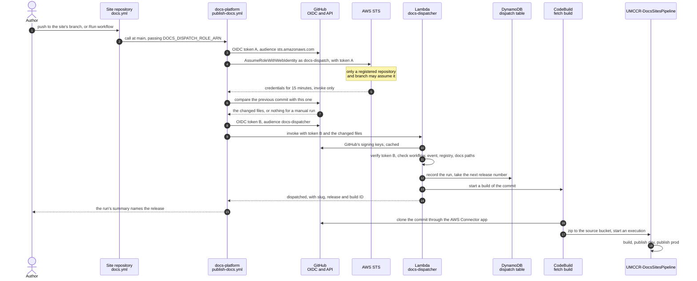
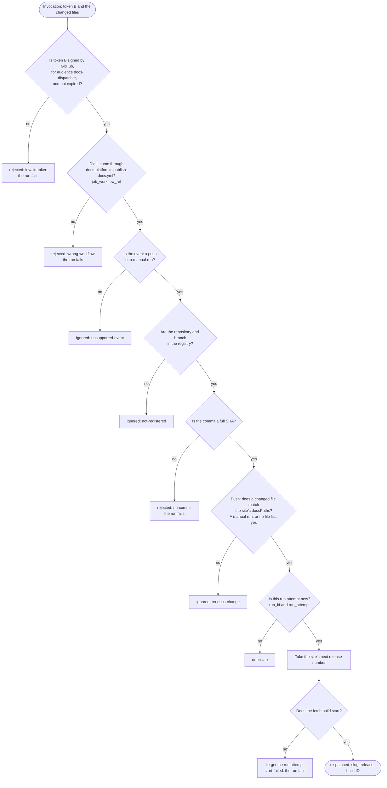

# Plan: publishing from GitHub

> **Status: plan, not in effect.** Publishing still runs as [ADR-0006](../design/adr/0006-dispatched-publishing.md)
> and [deploy.md](../site/deploy.md) describe: the organisation webhook calls the dispatcher's function URL, which
> checks the webhook's signature. This page is the plan for replacing that, proposed in
> [ADR-0009](../design/adr/0009-dispatch-from-github-actions.md) and deferred on 2026-10-15
> ([issue](../issues/2026-10-14-dispatcher-function-url.md)). An implementation with tests was written on
> 2026-10-14 and reverted before merge; [what implementing it changes](#what-implementing-it-changes) records it.

How a push to a site's repository would become a release under the plan, and how to deploy it. For the platform
team.

## In short

A site's repository runs a short workflow on each push to its branch. The workflow calls the shared workflow in this
repository, which signs in to the toolchain account through GitHub OIDC as `docs-dispatch`, a role that can do one
thing: invoke the dispatcher. It hands the dispatcher a second GitHub OIDC token, in which GitHub vouches for the
repository, branch and commit. The dispatcher checks that token against the site registry and starts the fetch
build, which starts `UMCCR-DocsSitesPipeline`.

Nothing on this path can be invoked from the internet, and no site repository holds a credential.

## The pieces

| Piece | Where | What it does |
| --- | --- | --- |
| The site's workflow | `.github/workflows/docs.yml` in each site's repository, copied from `toolkit/templates/docs-workflow.yml` (new) | runs on a push to the site's branch, or on **Run workflow**, and calls the shared workflow with the organisation secret |
| The platform site's workflow | `.github/workflows/platform-site.yml` (new) | the same, for `/platform/` |
| The shared workflow | `.github/workflows/publish-docs.yml` (new) | signs in as `docs-dispatch`, finds the changed files, invokes the dispatcher and reports its answer |
| Organisation secret `DOCS_DISPATCH_ROLE_ARN` | the umccr organisation's Actions secrets | the role's ARN; keeps the account ID out of public repositories and their logs. Not a credential |
| GitHub OIDC provider | toolchain account, `infrastructure/toolchain/dispatcher.ts` (changed) | lets GitHub Actions sign in to the account. IAM allows one per account; this stack would own it |
| Role `docs-dispatch` | the same | trusts only the registered repositories and branches; may only invoke the dispatcher |
| Lambda `docs-dispatcher` | `app/dispatcher/` (changed) | verifies the token, decides, numbers the release and starts the fetch build. No URL, no resource policy |
| Dispatch table | DynamoDB, in the same stack | the workflow runs already handled, and each site's release counter |
| Fetch build and `UMCCR-DocsSitesPipeline` | [`fetch-build.ts`](../../infrastructure/toolchain/fetch-build.ts), [`sites-pipeline.ts`](../../infrastructure/toolchain/sites-pipeline.ts) | clone the commit, zip it, then build and publish to dev, then prod |

## The whole path



The workflow run takes seconds, the fetch build a minute or two, and the release is usually live a few minutes after
the push.

## Step by step

### 1. The site's workflow starts it

The site's `.github/workflows/docs.yml` runs on a push to the site's branch (`main` in the template) and on **Run
workflow**. Its calling job grants two permissions: `id-token: write`, so that the job can ask GitHub for OIDC
tokens, and `contents: read`, for the compare API. It calls the shared workflow at `main` and passes the
organisation secret. A called workflow can never have more permissions than its caller grants.

### 2. The shared workflow signs in to AWS

1. **Check the organisation secret**: a secret the repository cannot see arrives empty, so the job stops with a
   clear error instead of failing later on missing credentials.
2. **Sign in to AWS as docs-dispatch**: `aws-actions/configure-aws-credentials`, pinned to a commit, asks GitHub for
   token A, with audience `sts.amazonaws.com`, and calls `AssumeRoleWithWebIdentity`. IAM accepts only a token from
   GitHub's OIDC provider whose subject is exactly one of the registered pairs, generated from
   [`infrastructure/sites.ts`](../../infrastructure/sites.ts):

   ```text
   repo:umccr/docs-platform:ref:refs/heads/main
   repo:umccr/management-knowledgebase:ref:refs/heads/main
   ```

   Any other repository, a fork, a pull request, or another branch fails here. The credentials last 15 minutes and
   allow only `lambda:InvokeFunction` on `docs-dispatcher`. The account ID is masked in the log.

### 3. The shared workflow asks the dispatcher

1. **The changed files.** Actions' copy of the push event does not list them, so the step asks GitHub's compare API
   for `<previous commit>...<this commit>`, renamed files included. It sends `null` instead for a manual run, a new
   branch, a failed comparison or 300 files or more (the API's limit), and the dispatcher then assumes the docs
   changed.
2. **Token B**: a second OIDC token, with audience `docs-dispatcher`. It is masked in the log, passed to `jq`
   through the environment rather than the command line, and deleted from the runner's disk when the step ends.
3. **The request**: `aws lambda invoke --function-name docs-dispatcher` with `{"token": "<token B>", "files": [...]}`,
   using the role's credentials: a direct, synchronous call, with no URL involved.
4. **The answer**: the step writes it to the run's summary, and fails the run on `rejected`, `start-failed` or an
   error in the function. An error's message can name AWS resources, so only its type is printed.

Two tokens, because the role only proves that *some* registered repository and branch is calling. Token B proves
which repository, branch and commit, signed by GitHub, so a site cannot ask for another site's release, or for a
commit it did not push. The two audiences differ, so neither token is accepted in the other's place.

### 4. The dispatcher decides

The changed `app/dispatcher/dispatch.ts` checks, in this order, and answers at the first check that fails:



- The repository, branch and commit come from token B's signed claims, never from the request body; the slug,
  configuration path, toolkit version and stages come from the registry. The changed files are the only thing the
  request decides, and they only decide whether to build.
- The token is verified with `aws-jwt-verify`, already a dependency, against the keys GitHub publishes at
  `https://token.actions.githubusercontent.com/.well-known/jwks`. The dispatcher fetches them once per
  execution environment, and again when a token names a key it does not hold.
- Recording the run attempt before taking a release number means an invocation the AWS CLI retries starts nothing
  twice. **Re-run** in GitHub is a new attempt, so it publishes again. A failed start forgets the attempt, so a retry
  can start the build.
- The dispatcher logs one line per request, with the repository, branch, commit, event and run. It never logs the
  token.

### 5. From the dispatcher to the site

1. The dispatcher starts the fetch build with the site, commit, release, configuration path, toolkit ref and stages
   as variables, and the GitHub connection as the source's credentials.
2. The fetch build clones that commit through the organisation's AWS Connector for GitHub app, zips it without
   `.git` to `sources/<slug>/<commit>.zip`, and starts `UMCCR-DocsSitesPipeline` on that object.
3. `UMCCR-DocsSitesPipeline` builds the site with no write access, then publishes it to dev and then prod as
   `docs-publisher`, narrowed to the site's own prefixes. A publish skips when a newer release is already live.

## The dispatcher's answers

| Answer | When | The run | What to do |
| --- | --- | --- | --- |
| `dispatched` | a release started | succeeds; the summary names the release and build | watch `UMCCR-DocsSitesPipeline` |
| `ignored`, `no-docs-change` | the push changed nothing under the site's `docsPaths` | succeeds | nothing; **Run workflow** publishes anyway |
| `ignored`, `not-registered` | the repository or branch is not in the deployed registry. Rare: the role refuses these first | succeeds | register the site ([onboarding](../site/runbook.md#register-a-site)) |
| `ignored`, `unsupported-event` | an event other than a push or a manual run | succeeds | nothing |
| `duplicate` | the same run attempt asked twice, for example an invocation the AWS CLI retried | succeeds | nothing |
| `rejected`, `invalid-token` | token B failed its signature, issuer, audience or expiry check | fails | use the shared workflow unchanged; the dispatcher's log names the check |
| `rejected`, `wrong-workflow` | the request did not come through `publish-docs.yml` | fails | call the shared workflow, as the template does |
| `start-failed` | the fetch build could not start | fails | the dispatcher's log has the AWS error; fix it, then **Re-run** |
| none: the run fails at **Sign in to AWS** | the role refused the token: the repository and branch are not in the deployed registry, or the run is on another branch | fails | register the site and let pipeline 1 deploy it; run on the registered branch |
| none: the run fails at **Check the organisation secret** | `DOCS_DISPATCH_ROLE_ARN` is missing, or not shared with the repository | fails | an organisation owner shares the secret |
| none: the run fails before it starts, the nested job requesting `id-token: write` | the calling job does not grant `id-token: write` and `contents: read` | fails | use the template unchanged |

## What each control stops

| Threat | Stopped by |
| --- | --- |
| Anyone on the internet invoking the dispatcher | no function URL and no resource policy; only `docs-dispatch` may invoke it |
| An unregistered repository, a fork, a pull request or another branch publishing | the role trusts exact `repo:<owner>/<name>:ref:refs/heads/<branch>` subjects only |
| A site asking for another site's release, or for a commit it did not push | the repository, branch and commit come from GitHub's signature on token B; the slug comes from the registry |
| The AWS sign-in token used as a dispatcher request, or the other way round | the two tokens have different audiences |
| A hand-written workflow sending a crafted request | the `job_workflow_ref` check: only `publish-docs.yml` is accepted |
| One request starting two builds | the run attempt is recorded before the release number is taken |
| The toolchain account's ID or AWS details in public logs | the organisation secret, `mask-aws-account-id`, and AWS errors kept in the dispatcher's own log |
| A leaked token | both expire within minutes; token B is masked in logs and deleted from the runner |

## What implementing it changes

The implementation written on 2026-10-14 passed every check CI runs (328 tests, lint, format, actionlint, zizmor,
detect-secrets, the information boundary) and a template diff against the deployed toolchain stack, before it was
reverted. Re-creating it means:

| File | Change |
| --- | --- |
| `app/dispatcher/protocol.ts` | new: the contract shared by the Lambda, the CDK app and the tests: GitHub's issuer, the dispatcher's token audience `docs-dispatcher`, the shared workflow's path, the function name `docs-dispatcher` |
| `app/dispatcher/github-token.ts` | new: `JwtRsaVerifier` for GitHub's issuer, audience and keys, with 30 seconds' grace; reads `repository`, `ref`, `ref_type`, `sha`, `event_name`, `job_workflow_ref`, `run_id`, `run_attempt` |
| `app/dispatcher/dispatch.ts` | the request becomes `{token, files}`, and the checks become the ones in the flowchart above; the answer becomes `{outcome, reason, slug, commit, release, buildId}`, with AWS errors in the log only |
| `app/dispatcher/index.ts` | the token verifier replaces the Secrets Manager client; the table records `run#<run_id>-<run_attempt>` instead of webhook delivery IDs |
| `infrastructure/toolchain/dispatcher.ts` | no function URL and no secret; `functionName: 'docs-dispatcher'`; `OidcProviderNative` for `token.actions.githubusercontent.com`; role `docs-dispatch` with exact subjects from `dispatchRegistry()` and `lambda:InvokeFunction` on the function only; a synth-time check of the trust policy's length; output `DispatchRoleArn` |
| `infrastructure/config.ts` | `DOCS_DISPATCH_ROLE_NAME = 'docs-dispatch'` |
| `infrastructure/sites.ts`, `infrastructure/toolchain/site-publishing.ts` | doc comments: the workflow instead of the webhook |
| `.github/workflows/publish-docs.yml` | new: the shared workflow. `aws-actions/configure-aws-credentials` pinned to a commit, `role-duration-seconds: 900`, `mask-aws-account-id: true` |
| `.github/workflows/platform-site.yml` | new: calls it with `./`, which needs a `zizmor: ignore[self-repository]` until the pinned actionlint accepts `$/` |
| `toolkit/templates/docs-workflow.yml` | new: the site's caller, at `@main`, explaining when to pin a commit instead |
| `scripts/check-dispatcher.sh` | new: the post-deploy check in step 3 below |
| `test/dispatcher.test.ts`, `test/github-token.test.ts`, `test/publish-workflow.test.ts`, `test/pipeline-stack.test.ts` | the dispatcher's checks; the verifier against real RSA signatures; the workflow's own script against stubbed `gh`, `curl` and `aws`; no function URL, the role's trust and policy, the trust policy's length. Drop `AwsSolutions-SMG4` from the accepted rules: the secret goes |
| `docs/site/deploy.md`, `docs/site/runbook.md`, `docs/site/design.md`, `docs/site/publishing.md`, `docs/site/onboarding.md`, `README.md`, `SECURITY.md`, `docs/site/changelog.md` | the workflow instead of the webhook; ADR-0009 to accepted, and ADR-0006 to superseded in part |

Each site's repository gains `.github/workflows/docs.yml` from the template.

## Deploying it

The order matters: the sites call `publish-docs.yml` at `main`, and the knowledgebase builds with the toolkit at
`main`, so this repository goes first.

### Before you start

| For | You need |
| --- | --- |
| Steps 1, 3, 5 and 6 | admin on the toolchain (bastion) account through AWS SSO, here the `bastion-admin` profile |
| Step 5's site check | the `dev` profile, for the dev account |
| Step 4 | an owner of the umccr GitHub organisation |
| Steps 2 and 6 | merge rights on `umccr/docs-platform` and `umccr/management-knowledgebase` |

Tools: AWS CLI v2, Node.js 22 or later with Corepack, `jq`, and optionally the GitHub CLI, `gh`.

### 1. Pre-flight, read-only

```sh
aws sso login --profile bastion-admin && export AWS_PROFILE=bastion-admin AWS_REGION=ap-southeast-2

aws iam list-open-id-connect-providers --output text | grep token.actions.githubusercontent.com  # expect nothing
aws iam get-role --role-name docs-dispatch               # expect NoSuchEntity
aws lambda get-function --function-name docs-dispatcher  # expect ResourceNotFoundException
```

If a GitHub OIDC provider already exists, stop: the deploy would fail with `EntityAlreadyExists`. Find what uses it,
then either delete it, if nothing does, or change `DocsDispatcher` to use it by its ARN.

### 2. Implement and merge

Re-create the changes [above](#what-implementing-it-changes) on a branch, then:

```sh
cd docs-platform
make install
make test     # jest, including the dispatcher, the token checks and the workflow's own script
make check    # formatting, lint, actionlint, zizmor, secrets, the information boundary
```

Open the pull request and merge it to `main`. The merge runs `platform-site.yml`, which fails at **Sign in to AWS**:
the role does not exist yet. That is expected; step 5 runs it again.

### 3. Deploy the toolchain stack

```sh
git switch main && git pull --ff-only
corepack enable && pnpm install --frozen-lockfile
pnpm cdk diff DocsInfrastructurePipeline --method template
pnpm cdk deploy DocsInfrastructurePipeline   # review the IAM changes when asked, then answer y
scripts/check-dispatcher.sh                  # every line should start with ✓
```

Over the first design's stack, the diff shows exactly this:

| Change | Resource |
| --- | --- |
| added | the GitHub OIDC provider; role `docs-dispatch` and its invoke-only policy; output `SitePublishingDispatcherDispatchRoleArn…` |
| replaced | the dispatcher, which gains the fixed name `docs-dispatcher` |
| removed | the function URL, both of its invoke permissions, the webhook secret and its outputs |
| changed | the fetch build's role gains `codeconnections:GetConnection` |
| unchanged | the dispatch table and its release counters, the log group, both pipelines, the buckets |

`scripts/check-dispatcher.sh` checks that the dispatcher has no function URL or resource policy, that
`docs-dispatch` trusts GitHub OIDC with exact subjects and may only invoke the dispatcher, and that the fetch build
may read the connection. It then invokes the dispatcher once with a token nobody signed, which proves that the
function runs and reaches GitHub's keys; the answer is `rejected`, and nothing starts.

From the deploy until step 4, the old organisation webhook's deliveries fail: its URL is gone. That is harmless.

### 4. GitHub organisation settings

An organisation owner:

1. Reads the role's ARN, with toolchain credentials:

   ```sh
   aws cloudformation describe-stacks --stack-name DocsInfrastructurePipeline --output text --query \
     "Stacks[0].Outputs[?starts_with(OutputKey, 'SitePublishingDispatcherDispatchRoleArn')].OutputValue"
   ```

2. Adds it as an organisation secret: **Settings → Secrets and variables → Actions → New organization secret**,
   name `DOCS_DISPATCH_ROLE_ARN`. **All repositories** saves a step for each new site and gives nothing away: the
   ARN is not a credential, and the role only trusts registered branches. **Selected repositories** works too, if
   each site's repository is added.
3. Under **Settings → Actions → General**, if the organisation limits actions, allows
   `aws-actions/configure-aws-credentials` and reusable workflows from public repositories.
4. Deletes the first design's organisation webhook: **Settings → Webhooks**, the hook whose payload URL ends in
   `lambda-url.ap-southeast-2.on.aws`.

### 5. The first release of /platform/

Run the workflow by hand: **Actions → Publish the platform site → Run workflow** on `main`, or

```sh
gh workflow run platform-site.yml --repo umccr/docs-platform --ref main
```

Expect the run to succeed within seconds, its summary reading "Release `<n>` of platform at `<commit>` started:
build …". Release numbers only need to grow, so they can skip: a start that failed still used one. Then, with
toolchain credentials:

```sh
# The dispatcher's line for the run: outcome dispatched, with the repository, commit and release
LOG_GROUP=$(aws cloudformation describe-stack-resources --stack-name DocsInfrastructurePipeline --output text \
  --query "StackResources[?starts_with(LogicalResourceId, 'SitePublishingDispatcherLogGroup')].PhysicalResourceId")
aws logs tail "$LOG_GROUP" --since 15m

# The fetch build: SUCCEEDED, at the run's commit
FETCH=$(aws cloudformation describe-stack-resources --stack-name DocsInfrastructurePipeline --output text \
  --query "StackResources[?ResourceType=='AWS::CodeBuild::Project' && starts_with(LogicalResourceId, 'SitePublishingFetchBuild')].PhysicalResourceId | [0]")
aws codebuild batch-get-builds --query 'builds[0].[buildStatus, sourceVersion]' --output text --ids \
  "$(aws codebuild list-builds-for-project --project-name "$FETCH" --query 'ids[0]' --output text)"

# The site pipeline's latest executions
aws codepipeline list-pipeline-executions --pipeline-name UMCCR-DocsSitesPipeline --max-items 3 \
  --query 'pipelineExecutionSummaries[].[pipelineExecutionId, status, startTime]' --output table
```

And with dev credentials, the live release, then the site at `https://docs.dev.umccr.org/platform/`:

```sh
DOCS_BUCKET=$(aws ssm get-parameter --name /docs/content-bucket-name --query Parameter.Value --output text)
aws s3 cp "s3://$DOCS_BUCKET/sites/platform/_publish.json" -
```

### 6. The knowledgebase

In `umccr/management-knowledgebase`, commit:

- `.github/workflows/docs.yml`, the template's copy;
- `mkdocs.yml`, which the build needs at the pushed commit;
- every note that committed notes link to: the strict build fails on a link to a note that is not committed;
- the `README.md` section on the published site.

Before merging, build the commit the way the pipeline will: from committed content only (the recipe is in
[deploy.md, Publishing by hand](../site/deploy.md#publishing-by-hand), without the publish step). Then merge to
`main`. The push changes `mkdocs.yml` and notes under `PlatformServices/`, so its workflow run should answer `dispatched`. Check
it as in step 5, with `management-knowledgebase` in place of `platform`, and open
`https://docs.dev.umccr.org/management-knowledgebase/`.

### 7. After the rollout

- [ ] `scripts/check-dispatcher.sh` passes, every line ✓.
- [ ] Both sites are live in dev, and in prod once its hosting stack exists.
- [ ] A push outside a site's docs paths succeeds with "Nothing to publish: no-docs-change".
- [ ] **Run workflow** starts a release without a push.
- [ ] **Run workflow** on another branch fails at **Sign in to AWS**.
- [ ] The organisation has no webhook pointing at a `lambda-url` address.
- [ ] The first design's dispatcher is gone:
      `aws lambda list-functions --query "Functions[?starts_with(FunctionName, 'DocsInfrastructurePipelin-SitePublishingDispatcher')].FunctionName"`
      prints an empty list.

### Rolling back

Deploying `DocsInfrastructurePipeline` from the commit before this change brings back a public function URL, at a new
address, and a webhook secret with a new value, so an organisation owner would add the organisation webhook again
with both, as [deploy.md step 5](../site/deploy.md#step-5-github) describes today. Until a fix lands, sites can be
published [by hand](../site/deploy.md#publishing-by-hand) instead, which avoids reopening the function.

## Adding a site later

1. Register it in `infrastructure/sites.ts`, and let pipeline 1 deploy the change: the self-update adds the routing
   entry and the role's trusted subject together ([registering a site](../site/runbook.md#register-a-site)).
2. Copy `toolkit/templates/docs-workflow.yml` to `.github/workflows/docs.yml` in the site's repository, with the
   registered branch under `on.push`.
3. If the organisation secret or the AWS Connector app is limited to selected repositories, add the site's
   repository to each.
4. **Run workflow** for the first release.

IAM limits the role's trust policy to 2,048 characters by default, about 30 sites; `cdk synth` fails before the
registry outgrows it. Raise the quota to 4,096 when it gets close.
