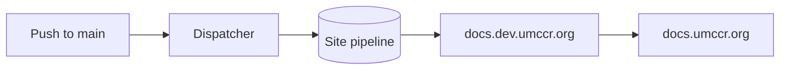
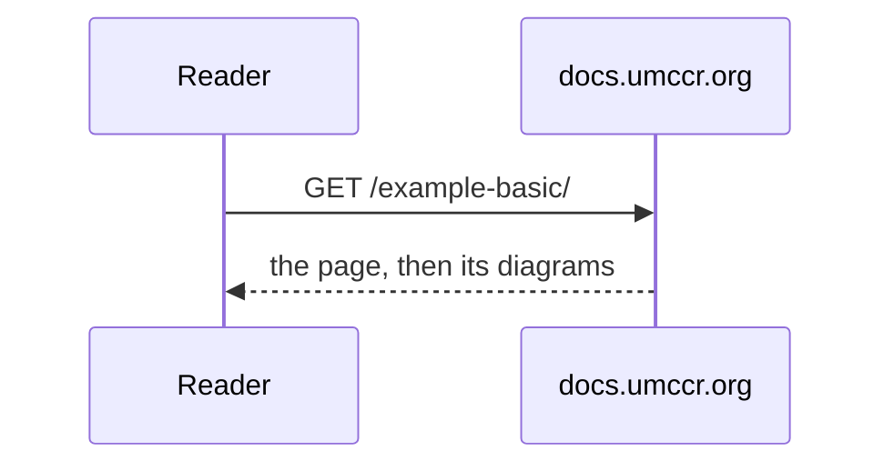

# Components

Every element the theme styles, on one page, so a change to the theme can be checked in one place. Run
`umccr-docs serve` in this example's folder and open this page.

## Callouts

!!! note
    The slug is permanent: renaming it moves the site's URL.

!!! tip
    The site appears in the catalogue shortly after it publishes.

!!! warning "Before you push"
    A callout with its own title and two paragraphs.

    The second paragraph sits below the first.

!!! danger
    Something that cannot be undone.

!!! example
    An example of a callout.

!!! quote
    A quotation, set apart.

??? info "Folded detail"
    Hidden until it is opened.

???+ success "Open detail"
    Shown until it is closed.

## Code

```sh
pip install --no-deps <docs-platform>/toolkit
umccr-docs serve
```

```yaml title="mkdocs.yml"
site_name: Example site
site_url: https://docs.umccr.org/example-basic/
docs_dir: docs
```

```python
def greet(name: str) -> str:
    """Say hello."""
    return f"Hello, {name}"
```

```text
Plain text has no header.
```

Inline `code`, a key combination, ++ctrl+k++, and ==highlighted text==.

A bare URL is a link, as on GitHub: https://docs.umccr.org/platform/.

## Diagrams

A `mermaid` code block is drawn as a diagram, fitted to the page. A click on one that had to shrink shows it at full
size.





## Tables

| Field    | Example      | Meaning                                |
| -------- | ------------ | -------------------------------------- |
| `slug`   | `my-service` | the site's path                        |
| `branch` | `main`       | pushes to this branch publish the site |
| `stages` | dev and prod | where it is published                  |

## Lists

- An item
    - A nested item
- Another item

In order:

1. First
2. Second

Tasks:

- [x] A finished task
- [ ] An open task

Term
:   Its definition.

> A quotation in the text.

A sentence with a footnote.[^1]

[^1]: The footnote.

### A third-level heading

#### A fourth-level heading
